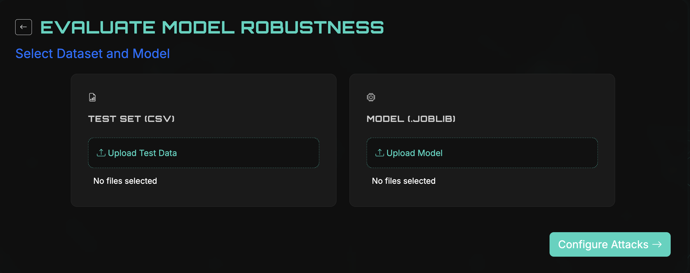
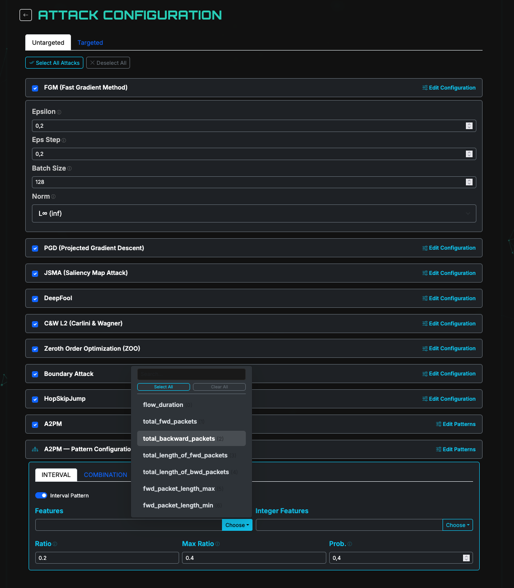
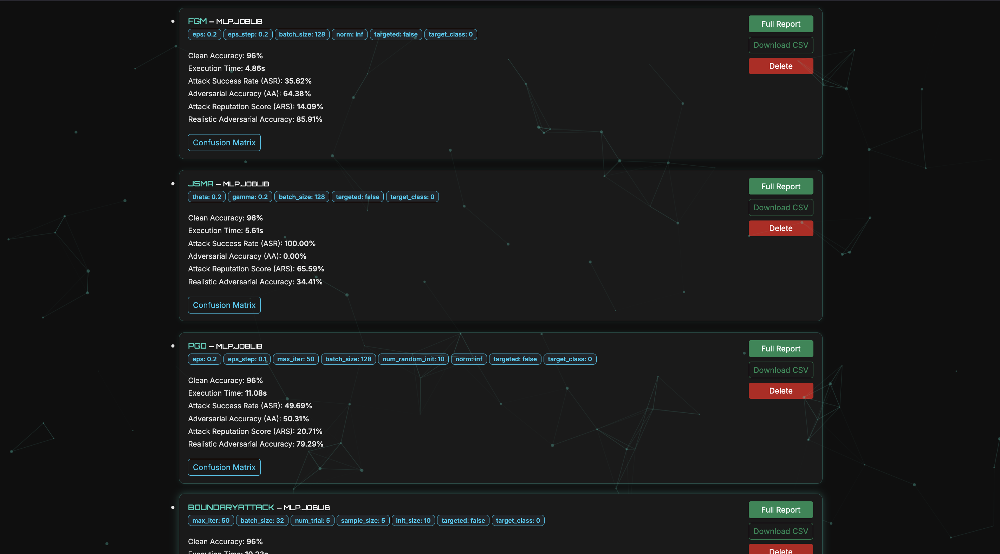

# ARB4NID

**Adversarial Robustness Benchmark for Network Intrusion Detection**

ARB4NID is a tool for evaluating the robustness of Machine Learning models used in Network Intrusion Detection Systems (NIDS) against adversarial attacks.

---

## Prerequisites

ARB4NID requires **Python 3.11**. Check whether you already have it:

```bash
python3.11 --version
```

If the command is not found, install Python 3.11 first:

- **Recommended — [pyenv](https://github.com/pyenv/pyenv)** (installs Python 3.11 without affecting your system Python):
  ```bash
  # macOS (Homebrew):
  brew install pyenv

  # Linux:
  curl https://pyenv.run | bash

  # then, on any OS:
  pyenv install 3.11.9
  ```

- **Alternative** — download the installer directly from [python.org/downloads](https://www.python.org/downloads/) and install Python 3.11.

You also need **Git** ([git-scm.com](https://git-scm.com/downloads)) to clone the repository, or you can download the project as a ZIP from the GitHub page.

---

## Getting Started

Follow these steps to run the project locally.

**1. Clone the repository**

```bash
git clone https://github.com/antoniosantos1602/ARB4NID.git
```

**2. Create and activate a virtual environment** (Python 3.11)

```bash
pyenv local 3.11.9

python3.11 -m venv venv
source venv/bin/activate
```

**3. Install the dependencies**

```bash
pip install -r requirements.txt
```

**4. Run the application**

```bash
python app.py
```

---

## Running with Docker

As an alternative to the local setup above, ARB4NID can run in a Docker container (Linux, CPU only). The container uses its own dependency list, [`requirements-docker.txt`](requirements-docker.txt). The `requirements.txt` file is only for the local macOS setup and is not used by Docker.

### Requirements

- **Docker** ([docs.docker.com/get-docker](https://docs.docker.com/get-docker/)): Docker Desktop on macOS/Windows, Docker Engine on Linux.
- About **8 GB of free disk space**. The image is about 2.6 GB, because it includes PyTorch and TensorFlow.
- **At least 4 GB of RAM** for the container. The application uses about 700 MB when idle, and each attack process loads PyTorch and TensorFlow again (about 1 GB each).

### 1. Build the image

From the project root:

```bash
docker build --platform linux/amd64 -t arb4nid:local .
```

The first build takes several minutes because it downloads PyTorch and TensorFlow. Later builds reuse the cached layers and are much faster, as long as `requirements-docker.txt` does not change.

> **Apple Silicon (M1/M2/M3):** keep `--platform linux/amd64`. This builds the same image that runs on x64 cloud VMs. On a Mac it runs through emulation, so it is slower than on a Linux server.

### 2. Run the container

```bash
docker run -d --name arb4nid \
  -p 8000:8000 \
  -e SECRET_KEY="change-me" \
  -e ARB4NID_MAX_WORKERS=2 \
  -v arb4nid-uploads:/app/uploads \
  --restart unless-stopped \
  arb4nid:local
```

Open **http://localhost:8000**. The application takes about 30 seconds to start.

| Option | Purpose |
|:---|:---|
| `-p 8000:8000` | Exposes the application on port 8000 (`host:container`). |
| `-e SECRET_KEY=...` | Flask secret key. Always set it to a random value outside your own machine (e.g. `openssl rand -hex 32`). |
| `-e ARB4NID_MAX_WORKERS=2` | Number of parallel attack processes (default `6`). Lower it on machines with little RAM: allow about 1 GB per process. |
| `-v arb4nid-uploads:/app/uploads` | Keeps uploaded datasets and models in a Docker volume, so they survive container restarts and updates. |
| `--restart unless-stopped` | Starts the container again after a crash or a reboot of the machine. |

### 3. Check that it is running

```bash
curl http://localhost:8000/health
```

The response should be `{"status":"ok"}`. Docker uses the same endpoint for its built-in health check: `docker ps` shows the container as `healthy` once it is ready.

### Useful commands

```bash
docker logs -f arb4nid          # follow the logs
docker stats arb4nid            # CPU / memory usage
docker stop arb4nid             # stop
docker start arb4nid            # start again
docker rm -f arb4nid            # remove the container (the uploads volume is kept)
docker volume rm arb4nid-uploads  # also delete the uploaded files
```

### Update to a new version

```bash
git pull
docker build --platform linux/amd64 -t arb4nid:local .
docker rm -f arb4nid
# then run the "docker run" command from step 2 again
```

### Run the tests and lint inside the image

The tests are not copied into the image, so they are mounted when the container starts:

```bash
docker run --rm --platform linux/amd64 \
  -v "$PWD/tests:/app/tests:ro" \
  -v "$PWD/pytest.ini:/app/pytest.ini:ro" \
  arb4nid:local \
  sh -c "pip install --user -q pytest pytest-flask && python -m pytest -q -p no:cacheprovider"

docker run --rm -v "$PWD:/src:ro" -w /src ghcr.io/astral-sh/ruff:0.8.6 check --no-cache .
```

### Use an image from Azure Container Registry

If the image has already been pushed to a registry (e.g. `arb4nid.azurecr.io`), you can pull it there instead of building it:

```bash
az login
az acr login --name arb4nid

docker pull arb4nid.azurecr.io/arb4nid:<tag>
```

Then use the `docker run` command from step 2, replacing `arb4nid:local` with `arb4nid.azurecr.io/arb4nid:<tag>`.

### How the image is built

- Base image: `python:3.11-slim-bookworm`, pinned by digest.
- PyTorch CPU wheels (no CUDA) and `tensorflow-cpu` / `xgboost-cpu`, which keep the image much smaller.
- The application is served by **gunicorn** with 1 worker and 4 threads. Results are kept in memory, inside one process, so only one worker is used.
- The container runs as a non-root user (`app`, uid 10001).
- `uploads/`, `*.joblib`, `*.csv`, `tests/`, `docs/` and `.git` are excluded from the image (see [`.dockerignore`](.dockerignore)).

## Screenshots

| Dataset & Model Selection | Attack Configuration | Results Dashboard |
|:---:|:---:|:---:|
|  |  |  |

---

## Usage

1. **Submit the inputs** — upload a test dataset (CSV) and one or more pre-trained models in `.joblib` format.
2. **Automatic analysis** — ARB4NID inspects the dataset and discovers the domain realism constraints (binary/integer features, dependencies, and statistical references).
3. **Configure the attacks** — choose the attack methods, the mode (untargeted / targeted), and adjust the parameters (if you want).
4. **Analyse & export** — inspect the interactive dashboards and export per-model reports and adversarial datasets (CSV).

### Input format

- **Dataset:** a CSV file.
- **Model:** a trained model stored in `.joblib` format. If normalization was used during training, store the scaler together with the model so the same preprocessing is reproduced.
- Multiple models can be evaluated in the same run.

---

## Available Attacks

ARB4NID integrates a range of adversarial attacks from the ART and Foolbox libraries and the A2PM method, covering white-box, gray-box, and black-box scenarios.

| Attack Method | Knowledge | Objective |
|:---|:---:|:---:|
| FGM | White-Box | Targeted / Untargeted |
| PGD | White-Box | Targeted / Untargeted |
| JSMA | White-Box | Targeted / Untargeted |
| C&W | White-Box | Targeted / Untargeted |
| DeepFool | White-Box | Untargeted |
| ZOO | Black-Box | Targeted / Untargeted |
| Boundary Attack | Black-Box | Targeted / Untargeted |
| HopSkipJump | Black-Box | Targeted / Untargeted |
| A2PM | Gray-Box | Targeted / Untargeted |

---

## Evaluation Metrics

- **Adversarial Accuracy (AA)**
- **Attack Success Rate (ASR)**
- **Attack Reputation Score (ARS)**
- **Realistic Adversarial Accuracy (RAA)**

---

## Robustness Evaluation

Robustness is measured through the **RAA**: higher values mean higher robustness. Because an attacker only needs one effective strategy while a defender must resist them all, two indicators are considered jointly:

- **RAA Mean** — the average RAA across all evaluated attacks (overall behaviour).
- **RAA Min** — the lowest RAA among the attacks (worst-case, revealing specific weaknesses).

Each attack's RAA maps to a robustness level:

| RAA (%) | Robustness Level |
|:---:|:---:|
| 90 – 100 | Very High |
| 70 – 90 | High |
| 50 – 70 | Moderate |
| < 50 | Low |

Combining **RAA Mean** and **RAA Min** (using 70% for the mean and 50% for the minimum), each model is classified into one of four profiles:

| Profile | Condition |
|:---|:---|
| **Highly Robust** | Mean ≥ 70% and Min ≥ 50% |
| **Robust but Vulnerable** | Mean ≥ 70% and Min < 50% |
| **Moderately Robust** | Mean < 70% and Min ≥ 50% |
| **Low Robustness** | Mean < 70% and Min < 50% |

---
